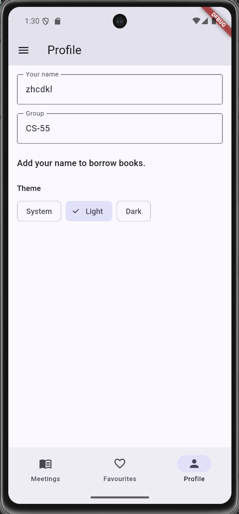
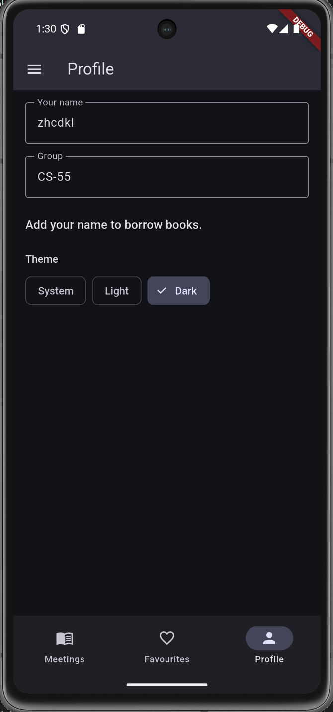
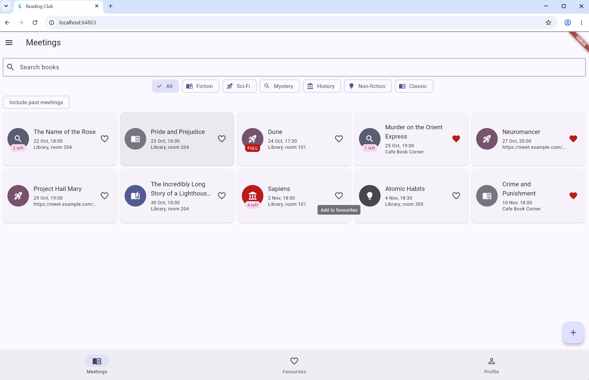

# Reading Club

A Flutter app for a student reading club. Every **meeting** is about one book:
title, genre, meeting date, place (or a link when the meeting is online), and the
number of copies. Members **borrow** a copy, so the app tracks copies against the
readers who borrowed them. Twelve seed meetings are included, dates relative to today.

## Screenshots

| Phone, light | Phone, dark | Tablet grid |
|---|---|---|
|  |  |  |

## Decisions

The list of meetings and the profile live in the shell's State, so all three tabs read one source of truth and send changes up through callbacks. The detail screen takes callbacks through its route arguments because it is a pushed screen with no access to the shell's State, and it keeps its own copy of the item so the Readers count updates immediately. The form returns a value through `pop` instead of calling a callback, so backing out simply returns `null` and the caller does nothing. The list switches between `ListView.separated` and a `GridView` with a `LayoutBuilder` because it must react to the space the widget is given, not the size of the whole screen. The `PopScope` on the form compares the current field values with a snapshot taken when the form opened, so retyping the original text is not "dirty" and Save never asks. ThemeMode lives in `MyApp` above `MaterialApp`, which is the only place that can switch the theme. With week 9's tools I would move the items and the profile out of the shell's State so the tabs and screens read them directly instead of passing them down and calling callbacks back up.

